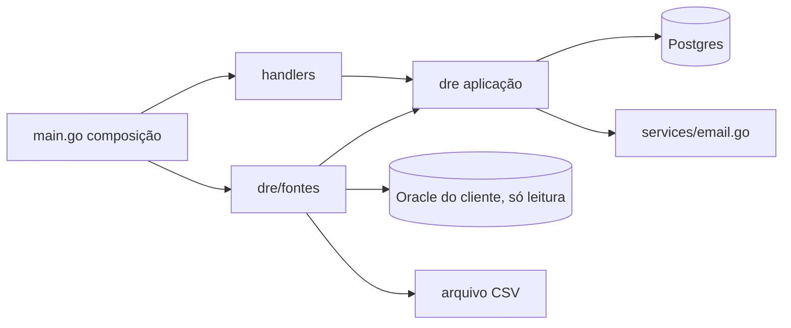
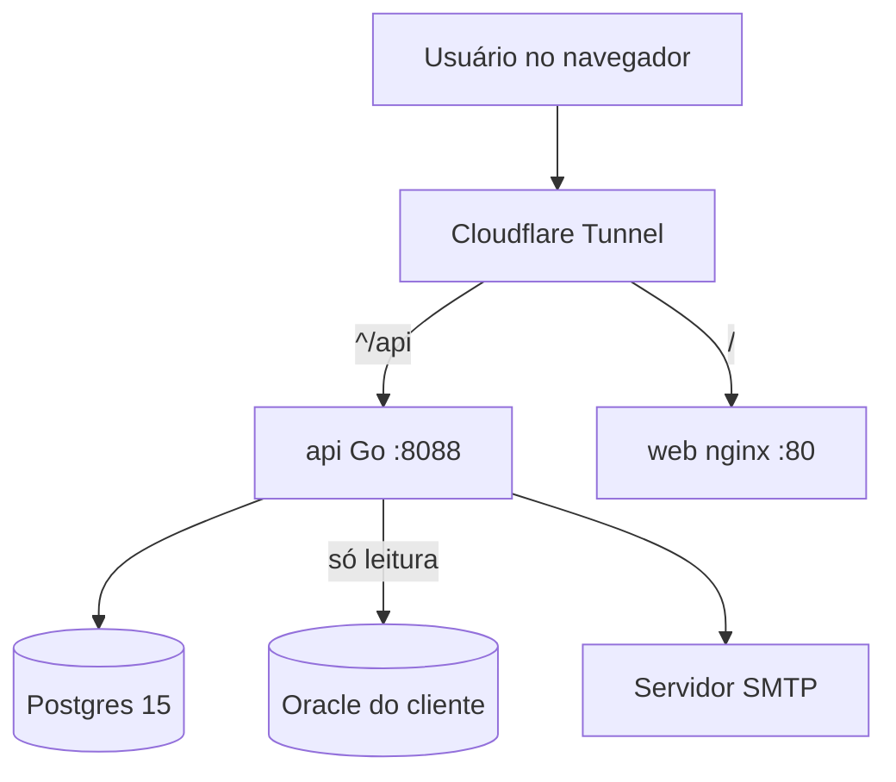
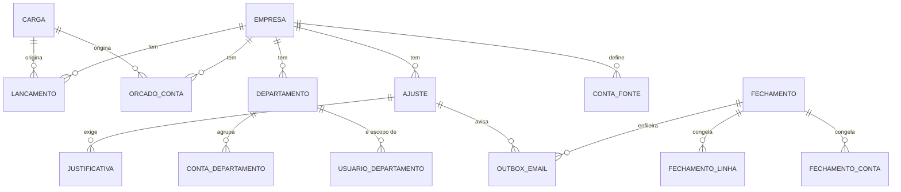

# Architecture Spine — FB_AUDITORIA, Release A1

## Design Paradigm

Monólito modular em camadas. Os handlers são adaptadores HTTP finos. A regra que precisa de um único guardião mora no pacote `dre`. As fontes de dados são adaptadores plugáveis (portas e adaptadores só na borda de ingestão).

| Camada | Onde | Papel |
| --- | --- | --- |
| Adaptadores HTTP | `backend/handlers/` | autenticação, decodificação, resposta; sem regra de período, escopo ou escrita de lançamento |
| Aplicação | `backend/dre/` | módulos `ingest`, `periodo`, `fechamento`, `escopo`, `ajuste`, `justificativa`, `rateio`, `envio`, `dicionario`, `ambiente` |
| Adaptadores de fonte | `backend/dre/fontes/` | Oracle (leitura) e CSV; implementam a porta `Fonte` definida em `dre` |
| Composição | `backend/main.go` | liga handlers, serviços e fontes |

**Existente × novo** (verificado no código em 27/10/2026):

| Já existe | Novo nesta release |
| --- | --- |
| `audit_log` imutável e `writeAuditLogTx`; `AuditoriaAuthMiddleware`; `dre_linhas`, `dre_mapa`, `lancamentos` (com coluna `origem`), `dre_orcado`, `dre_fechamentos` e linhas congeladas; SMTP em `services/email.go` | pacote `dre`; `orcado_conta`; `ajustes`; `justificativas`; `conta_dicionario`, `departamentos`, `conta_departamento`, `usuario_departamentos`; `conta_fonte`; `dre_fechamento_contas`; `outbox_email`; `config_empresa`; `execucoes`; `perfis.go`; perfil `analista`; `ALLOW_SELF_REGISTER`; `companies.ambiente`; `users.bloqueado_em` |

Os handlers `dre.go` (fechamento) e `dre_import.go` ainda fazem `INSERT` e cálculo próprios; migram para `dre` na primeira história da release.

## Invariants & Rules



Setas são as únicas dependências permitidas. `dre` não importa `handlers` nem `fontes`; `fontes` não acessa Postgres.

### AD-1 — Camadas e direção de dependência

- **Binds:** all
- **Prevents:** regra de período e escopo duplicada em cada handler; adaptador de fonte gravando no banco por conta própria.
- **Rule:** handlers só chamam `dre`; `dre` define a porta `Fonte` e os tipos, e `fontes` os implementa; nenhuma seta fora do diagrama. Nenhum handler faz `INSERT` ou `DELETE` em tabelas de lançamento, orçado, ajuste ou fechamento.

### AD-2 — Fonte atrás de interface e escritores únicos

- **Binds:** FR-1, FR-2, FR-3, FR-20
- **Prevents:** handler com `INSERT` próprio; trocar CSV por Oracle exigir mexer no DRE; duas rotas gravando a mesma tabela.
- **Rule:** toda leitura externa implementa `Fonte` (`Nome`, `Ler(ctx, Escopo)`). Somente `dre.Ingestor` escreve em `auditoria.lancamentos` e `auditoria.orcado_conta`; somente `dre.Dicionario` escreve em `conta_dicionario`, `departamentos` e `conta_departamento`. Um teste falha o build se outro pacote contiver esses comandos.

### AD-3 — Idempotência por escopo e recusa por escopo

- **Binds:** FR-1, FR-2, FR-3, FR-11
- **Prevents:** duplicar lançamentos; apagar dado de outra fonte ou ajuste; mês fechado alterado por varredura; leitura vazia apagando história.
- **Rule:** `lancamentos` usa a coluna existente `origem` (ex.: `oracle.consolidado`, `csv.contas`); `orcado_conta` ganha a mesma coluna. A reimportação substitui por `(empresa, origem, competência, filial)` numa só transação. Escopo em período fechado é recusado: a varredura agendada o pula e registra; a carga explícita devolve `409` listando os escopos recusados. Uma leitura que devolve zero linhas nunca apaga o escopo; filial ausente do arquivo não é apagada; `filial` vazia é rejeitada em lançamento. A UF do consolidado é guardada em coluna própria (`uf`); a soma por filial acontece na consulta, e a substituição por escopo vale para todas as UFs da filial.

### AD-4 — Contas sintéticas e sinal só no Mapa

- **Binds:** FR-1, FR-6, FR-7
- **Prevents:** inversão de sinal em adaptadores; duas formas de mapear a mesma coluna.
- **Rule:** as colunas da view consolidada viram contas com prefixo `ERP.` (ex.: `ERP.VLFATBRUTO`). O valor é guardado como a fonte entrega. O sinal vive só em `dre_mapa.sinal`. Conta é sempre `TEXT`.

### AD-5 — Orçado por conta, resolvido pelo Mapa

- **Binds:** FR-2, FR-7, FR-8
- **Prevents:** orçado resolvido por um caminho e realizado por outro; zero fabricado; duas tabelas de orçado em uso.
- **Rule:** o DRE lê o orçado só de `auditoria.orcado_conta`, resolvido por `dre.ResolverConta` (a mesma função do realizado). `dre_orcado` (por linha) vira legado somente leitura: a rota de escrita é removida na primeira história e os dados migram em release posterior. Ausência de linha significa "sem orçado"; célula nula do mês não é gravada.

### AD-6 — Ajuste imutável

- **Binds:** FR-4, FR-7, FR-8
- **Prevents:** Realizado alterado em silêncio; reimportação apagar ajuste; sinal aplicado duas vezes.
- **Rule:** `auditoria.ajustes` é append-only por trigger (mesma função de `audit_log`), com `motivo` obrigatório e `criado_por` `NOT NULL`. O valor do ajuste está na convenção de sinal da fonte da conta; o sinal do Mapa é aplicado uma só vez, sobre `SUM(lancamentos) + SUM(ajustes)`, por um único caminho (`dre.Realizado`). Correção é novo ajuste de sinal oposto. O Ingestor nunca toca `ajustes`.

### AD-7 — Justificativa imutável, versionada e com chave canônica

- **Binds:** FR-12, FR-16
- **Prevents:** justificativa sobrescrita; a mesma divergência com chaves diferentes em tela, dashboard e e-mail; justificativa antiga valendo para outro valor.
- **Rule:** `auditoria.justificativas` é append-only. Para desvio, a chave é `desvio:<AAAA-MM>:<filial>:<conta>:<base>` com `base` em `orcado` ou `ano_anterior`, gerada só por `dre.ChaveDesvio`, e a justificativa guarda o valor do desvio no momento. Para ajuste, usa `ajuste_id` com chave estrangeira. A vigente é a de maior `id`. "Pendente", "justificada" e "a revisar" (valor mudou em competência aberta) são derivados, nunca persistidos. Escrever exige o escopo do autor (AD-10).

### AD-8 — Guarda de período, ponto único e atômico

- **Binds:** FR-1, FR-2, FR-3, FR-4, FR-11, FR-15
- **Prevents:** handler novo esquecer de checar o fechamento; escrita passar entre a checagem e o fechamento.
- **Rule:** `dre.Periodo.Guardar(tx, empresa, competência)` roda dentro da transação, antes de qualquer escrita em `lancamentos`, `orcado_conta`, `ajustes` ou `rateio_aplicado`. Toma `pg_advisory_xact_lock(dre.ChaveLock(empresa, competência))`, a única função de chave de lock, também usada por Fechar e Reabrir. Isolamento `READ COMMITTED` explícito. Fechado significa fechamento ativo da competência (o fechamento é sempre do grupo inteiro).

### AD-9 — Ciclo de vida do fechamento

- **Binds:** FR-9, FR-10, FR-11, FR-13
- **Prevents:** duas versões ativas; snapshot que perde ajuste; reabrir apagando história; limite retroativo.
- **Rule:** `dre_fechamentos` ganha `reaberto_em`, `reaberto_por`, `motivo_reabertura` (mudam uma só vez, por trigger, e exigem motivo) e `limite_desvio` (o vigente no fechamento). Um índice único parcial em `(empresa, competência) WHERE reaberto_em IS NULL` permite um só fechamento ativo; Fechar com ativo existente devolve `409`. Fechar toma o lock de AD-8 e calcula o snapshot dentro da transação, via `dre.Realizado`. Reabrir marca o ativo; novo Fechar cria a versão seguinte (`MAX+1` por `(empresa, competência)`). O fechamento é sempre do grupo inteiro: a coluna `filial` de `dre_fechamentos` fica vazia, e fechamentos por filial já gravados continuam legíveis. Aprovação do Controller é o próprio Fechar.

### AD-10 — Escopo por departamento, fail closed, leitura e escrita

- **Binds:** FR-6, FR-8, FR-12, FR-14, FR-16, FR-17, FR-18
- **Prevents:** Gerente ver ou justificar outro departamento por chamada direta à API; filtro só na interface; vazamento por subtotal ou percentual.
- **Rule:** tabelas `departamentos`, `conta_departamento` e `usuario_departamentos`; `dre.ResolverConta` devolve linha e departamento. O escopo é um `struct {Irrestrito bool; Deptos []string}` cujo valor zero não dá acesso. Todo SQL que devolve valor por conta, ajuste ou justificativa aplica `dre.FiltroEscopo`, e escrever (justificar, apontar ajuste) também exige o escopo. Ao Gerente o servidor devolve só linhas e totais do seu departamento; percentuais sobre Faturamento Líquido são calculados no servidor sem devolver a base. Conta sem departamento só aparece a perfis irrestritos. O casamento por prefixo é feito em Go, nunca com `LIKE`. O envio de e-mail monta o escopo a partir do destinatário.

### AD-11 — Autorização por capacidade, mecanismo único

- **Binds:** FR-4, FR-9, FR-10, FR-12, FR-13, FR-15, FR-18, FR-19
- **Prevents:** listas de perfil soltas e divergentes; dois mecanismos de autorização convivendo.
- **Rule:** `perfis.go` define as capacidades e a matriz abaixo. O middleware recebe uma capacidade; a assinatura com lista de perfis é removida na história do épico 4 que migra a última rota. Apagar dados de teste e virar para produção exigem admin de plataforma e a senha digitada de novo (AD-18). `analista` entra no `CHECK` de `users.perfil`.

| Perfil gravado | Papel no PRD | Capacidades |
| --- | --- | --- |
| `analista` (novo) | analista | ler, carregar, ajustar, editar mapa, estrutura e dicionário, configurar rateio |
| `controladoria` | Controller | as do analista, mais fechar, reabrir, aplicar rateio, definir limite, gerir usuários |
| `gestor` | Gerente | ler no seu escopo, justificar no seu escopo |
| `diretoria` | diretoria | ler |
| `auditoria` | legado, fora do PRD | ler (somente leitura) |

Admin de plataforma (`users.role = 'admin'`) mantém acesso total, como hoje. Um perfil `ti` (administração do ambiente da empresa: criar e bloquear usuários) é previsto para depois do A1; até lá, gerir usuários é do Controller e do admin de plataforma.

### AD-12 — Ids de área e migração [ADOPTED]

- **Binds:** FR-18, FR-19
- **Prevents:** usuário perder acesso ou ganhar a área errada; id antigo reaproveitado com significado novo.
- **Rule:** ids novos: `empresa` (rótulo "Administrativo": DRE, fechamentos, mapa, rateio, justificativas), `configuracoes`, `comercial` e `operacao`. Uma única migração com `UPDATE ... CASE` sobre `users.areas` (`estrategico`→`empresa`, `administrativo`→`configuracoes`, `operacional`→`operacao`), atualizando também o `DEFAULT` da coluna; nenhum id antigo é reutilizado. Backend, rotas e `navigation.ts` saem no mesmo release.

### AD-13 — E-mail por outbox genérica

- **Binds:** FR-4, FR-14
- **Prevents:** envio duplicado ou perdido sem rastro; DRE do grupo inteiro no e-mail; aviso de ajuste sem mecanismo.
- **Rule:** `auditoria.outbox_email` com `tipo` (`dre_departamento` ou `aviso_ajuste`), `chave_dedup` única (`fech:<id>:user:<uid>` ou `ajuste:<id>`), destinatários, corpo renderizado no enfileiramento e `status`. O DRE por departamento é enfileirado na transação do Fechamento e traz todos os departamentos do destinatário; em ambiente de teste (AD-18) o destinatário é só o administrador; o aviso de ajuste vai à `lista_aviso` de `config_empresa`. Um worker no processo da API drena com `FOR UPDATE SKIP LOCKED`, usando `services.GetEmailConfig`. A entrega é at-least-once, com `Message-ID` estável. Enfileirar e o resultado do envio gravam na trilha; falhas ficam legíveis ao Controller.

### AD-14 — Rateio como dado derivado

- **Binds:** FR-15
- **Prevents:** rateio misturado ao realizado direto; soma que não fecha; rateio defasado após reabertura.
- **Rule:** os percentuais de uma regra somam 100% (senão recusa). O resto de centavos vai à filial de maior percentual (empate: menor código), de modo que a soma rateada é exatamente o valor do departamento centralizado. O rateio é aplicado antes do Fechamento, sob a guarda (AD-8), gravado em `rateio_aplicado` e incluído no snapshot (AD-17); nunca escreve em `lancamentos`. Reabrir invalida o rateio aplicado da competência. O DRE por filial mostra o rateio como linha separada.

### AD-15 — Orquestração da ingestão Oracle

- **Binds:** FR-1, FR-2
- **Prevents:** duas execuções simultâneas; lock preso no pool; consulta sem limite no banco do cliente; credencial no código.
- **Rule:** gatilho manual do analista (obrigatório no A1); agendador opcional no processo da API, fuso `America/Sao_Paulo`, como última história. A exclusão mútua usa `pg_try_advisory_lock` numa `*sql.Conn` dedicada, com o unlock na mesma conexão (descartada se o unlock falhar); a escrita continua protegida pelo lock de transação de AD-8. Relê o histórico inteiro por escopo (volume pequeno). Cada execução grava em `auditoria.execucoes` (início, fim, status, resumo); a trilha de execução agendada usa `user_id` nulo e `origem = agendador`. Credenciais só em variáveis de ambiente (`JC_ORACLE_*`); ping de 30 s e consulta com timeout; nunca `SELECT` sem filtro. A empresa alvo vem de `JC_EMPRESA_ID` (inquilino único no A1).

### AD-16 — Dono da conta (uma conta, uma fonte)

- **Binds:** FR-1, FR-3, FR-20
- **Prevents:** a mesma conta vinda do Oracle e do CSV somar em dobro.
- **Rule:** `auditoria.conta_fonte (empresa_id, conta_padrao, origem)` define a fonte dona de cada conta. O Ingestor rejeita linha de conta cuja fonte dona é outra. Trocar o dono (por exemplo, de CSV para Oracle) é ação do Controller, vai à trilha e só vale para competências abertas.

### AD-17 — Leitura de período fechado

- **Binds:** FR-7, FR-8, FR-9, FR-14, FR-16
- **Prevents:** mês fechado mudar de significado ao vivo; drill-down divergir do snapshot; subtotal vazando receita ao Gerente.
- **Rule:** o fechamento congela `dre_fechamento_linhas` (agora com realizado, orçado e ano anterior) e `dre_fechamento_contas` (conta, linha, departamento, realizado, orçado, ano anterior, ajustes), ambas imutáveis por trigger. Toda leitura de competência fechada, inclusive detalhe e escopo do Gerente, usa só o snapshot. Mapa, estrutura e departamento só afetam meses abertos.

### AD-18 — Ambiente Teste ou Produção por empresa [ADOPTED]

- **Binds:** FR-21, FR-4, FR-9, FR-14
- **Prevents:** apagar dado real; voltar de Produção a Teste para apagar; e-mail de validação chegando a gerentes reais; o ambiente passar despercebido.
- **Rule:** `companies.ambiente` aceita `teste` ou `producao` (padrão `teste`); um trigger recusa `producao` para `teste`. A função `auditoria.limpar_dados_teste(empresa)` apaga lançamentos, orçado, ajustes, justificativas, fechamentos (linhas e contas), envios, cargas e execuções; mantém a estrutura do DRE, o Mapa, o dicionário, os departamentos e os usuários; não toca `audit_log`; e **recusa** se o ambiente não for `teste`. Os gatilhos de imutabilidade chamam `auditoria.imutavel_salvo_em_teste(empresa_id)`: só permitem `DELETE` quando o ambiente é `teste` e a sessão foi aberta pela função de limpeza (`set_config` local). Limpar e virar para `producao` exigem admin de plataforma e a senha digitada de novo, e gravam na trilha; a virada devolve a lista de contas cuja fonte dona ainda é arquivo (aviso, não bloqueio). O worker de e-mail consulta o ambiente: em `teste` envia só ao administrador. `/api/aud/me` informa o ambiente, e a interface mostra a faixa "AMBIENTE DE TESTE".

### AD-19 — Bloqueio de usuário no lugar da expiração por tempo

- **Binds:** FR-22, FR-18, FR-19
- **Prevents:** usuário perdendo acesso por passagem de tempo; usuário bloqueado seguindo com sessão aberta; o ambiente ficar sem nenhum administrador.
- **Rule:** `users` ganha `bloqueado_em`, `bloqueado_por` e `motivo_bloqueio`. O bloqueio é verificado no login, na renovação de sessão e em toda requisição do middleware (que já lê `users` a cada chamada), valendo na requisição seguinte. A verificação por `trial_ends_at` é **removida** do login e do middleware (a coluna passa a ser ignorada, e nenhum usuário novo recebe prazo); deixar o campo vazio não basta, porque o login o troca por "agora". Bloquear e desbloquear exigem motivo e gravam na trilha; ninguém bloqueia a si mesmo, e o último admin de plataforma ativo não pode ser bloqueado. A capacidade é "gerir usuários" (AD-11).

## Consistency Conventions

| Concern | Convention |
| --- | --- |
| Naming | tabelas em `snake_case` no schema `auditoria`; toda tabela de domínio tem `empresa_id`; pacotes Go em minúsculas sem sublinhado; migrations `NNN_descricao.sql` |
| Data & formats | `competencia` é `DATE` no dia 1; `valor` é `NUMERIC(18,2)`; `filial` é `TEXT` com o `CODFILIAL` (a UF nunca faz parte da chave); `conta` é `TEXT`; erros HTTP com texto simples e o status certo (`409` conflito de período, `403` fora de escopo) |
| State & cross-cutting | toda escrita relevante: transação + `writeAuditLogTx`; migrations aditivas e idempotentes, nunca tocam fechamentos; usuários são desativados e nunca apagados (tabelas append-only referenciam `users` com `ON DELETE RESTRICT`); gatilhos de imutabilidade usam `auditoria.imutavel_salvo_em_teste(empresa_id)` (AD-18) |
| Config | configuração de negócio por empresa (lista de aviso, limite de desvio, critérios) em `auditoria.config_empresa` (`chave`, `valor` JSONB); segredos e infraestrutura (SMTP, Oracle) em variáveis de ambiente; cadastro público desligado por `ALLOW_SELF_REGISTER=false`; nenhum endereço do banco do cliente no repositório |

## Stack

Versões lidas dos arquivos do projeto (go.mod, package.json, Dockerfiles, compose).

| Name | Version |
| --- | --- |
| Go | 1.26.1 (go.mod); imagem golang:1.26.10-alpine |
| github.com/lib/pq | v1.11.2 |
| github.com/sijms/go-ora/v2 | v2.9.0, última v2 (a v3 não conecta no servidor do cliente: teste registrado em jc_extrator.go do Farol, 29/07/2026) |
| github.com/golang-jwt/jwt/v5 | v5.3.1 |
| golang.org/x/crypto | v0.49.0 |
| PostgreSQL | 15 (postgres:15-alpine); suporte até 2027-11-11 |
| React / react-dom | ^18.3.1 |
| react-router-dom | ^6.30.6 |
| Vite | ^5.2.0 |
| TypeScript | ^5.2.2 |
| Tailwind CSS | ^3.4.3 |
| @tanstack/react-query | ^5.90.20 |
| Recharts | ^3.7.0 |
| nginx | stable-alpine |

## Structural Seed



**Implantação e operação.** Uma pilha Docker Compose no Coolify, numa VPS; existe só o ambiente de produção (desenvolvimento é local, com `dev.sh`). O `cloudflared` é o único caminho público: a API não publica porta no host. Segredos no Coolify; volume `auditoria_pg_data` para o Postgres; uma réplica da API. As migrations rodam no boot da API, são só para frente e são testadas num banco local antes do push; o caminho de volta é restaurar backup (ver Deferred). Observabilidade: log de requisições lentas, `auditoria.execucoes` e o status da outbox, visíveis ao Controller.



```text
backend/
  handlers/        # adaptadores HTTP (existente)
  dre/             # módulos: ingest, periodo, fechamento, escopo, ajuste,
                   #   justificativa, rateio, envio, dicionario, ambiente
    fontes/        # oracle, csv (implementam a porta Fonte)
  perfis.go        # capacidades e matriz de perfis
  services/email.go
  migrations/      # 004+ aditivas
  main.go          # composição
```

## Capability → Architecture Map

| Capability / Area | Lives in | Governed by |
| --- | --- | --- |
| FR-1 a FR-3, FR-20 Ingestão e dicionário | `dre/ingest`, `dre/dicionario`, `dre/fontes` | AD-2, AD-3, AD-4, AD-15, AD-16 |
| FR-4 Ajuste, FR-12 Justificativa | `dre/ajuste`, `dre/justificativa` | AD-6, AD-7, AD-8, AD-10, AD-13 |
| FR-5, FR-6 Estrutura e Mapa | handlers existentes + `dre` | AD-4, AD-10, AD-11, AD-17 |
| FR-7, FR-8, FR-16, FR-17 Visões | `dre.Realizado` + handlers | AD-5, AD-6, AD-10, AD-17 |
| FR-9 a FR-11 Fechamento | `dre/fechamento`, `dre/periodo` | AD-8, AD-9, AD-17 |
| FR-13 Limite | `config_empresa`, snapshot | AD-9, AD-11, convenção de Config |
| FR-14 E-mail | `dre/envio` | AD-13, AD-10 |
| FR-15 Rateio | `dre/rateio` | AD-14, AD-8, AD-17 |
| FR-18, FR-19 Perfis e cadastro | `perfis.go`, `auditoria_auth.go` | AD-10, AD-11, AD-12 |
| FR-21 Ambiente Teste ou Produção | `companies.ambiente`, `dre/ambiente` | AD-18, AD-11 |
| FR-22 Bloqueio de usuário | `auditoria_auth.go`, `auth.go`, tela de usuários | AD-19, AD-11 |

## Deferred

- **Backup e retenção** do volume do Postgres e da trilha: já existe um job no servidor do Coolify (cron diário às 23:00 UTC, `pg_dump -Fc` por stack, envio por `rclone` para `onedrive:FBTax-Backups/<data>/`, retenção de 56 dias, alerta por e-mail em falha), mas com **lista fixa de stacks** e `-U postgres`. A Auditoria não está na lista e o usuário `postgres` não existe aqui. Condição para o go-live com dado real: incluir a Auditoria (usuário lido de `POSTGRES_USER`) e **restaurar uma cópia num banco de teste** com sucesso.
- **Fonte real do Realizado por conta** (pergunta 1 do PRD): a porta `Fonte` e AD-16 isolam a troca. Revisitar quando o cliente responder.
- **Dicionário de contas** (pergunta 2): carga por arquivo via `dre.Dicionario` até haver fonte.
- **UF, `AC`, sinais das colunas e filiais sem orçado** (perguntas 3, 9 e 10): ficam no adaptador e em `dre_mapa.sinal`.
- **Rateio**: critério fixo ou mensal e quais departamentos são centralizados (perguntas 4 e 5).
- **Sensibilidade da folha** (pergunta 7): gancho é um marcador em `conta_departamento`; a regra espera a resposta.
- **Lista de aviso, limite de desvio inicial e quem lança ajuste** (perguntas 6 e 8): chaves de `config_empresa`; valores esperam o cliente.
- **Detalhe até o documento** (pergunta 11): `lancamentos` já tem `tipo_doc` e `doc_ref`; uma fonte no nível do lançamento os preencheria.
- **Retirada de `dre_orcado`**: migrar os dados para `orcado_conta` em release posterior.
- **Alerta externo** de falha de ingestão ou envio (hoje só visível na aplicação) e **entregabilidade do e-mail** (SPF e DKIM).
- **Dívida de versões e imagens**: `node:18-alpine` sem suporte desde 2025-04-30, Vite 5 fora da lista suportada, `lib/pq` v1.11.2 atrás da v1.12.3, `cloudflared:latest` e `alpine:latest` sem tag fixa, `go-ora` marcado `indirect` no `go.mod`. Nada bloqueia o A1.
- **Limpeza**: remover o host padrão do Oracle do `docker-compose.yml`, `.env.example` e `jc-probe`; resíduos do Farol em `services/email.go`; verificar `DeleteUserHandler` frente ao trigger de `audit_log` (`ON DELETE SET NULL` colide com o bloqueio de `UPDATE`).
- **Várias réplicas da API**: os locks já são seguros, mas o A1 roda com uma réplica.
- **Perfil `ti`** (administração do ambiente: criar e bloquear usuários): decidido para depois do A1; a matriz de capacidades (AD-11) comporta o novo perfil sem mudar as rotas.
